 

  

### We build software in more dimensions than one.

A small, senior-only studio turning ideas into **web, mobile and AI-powered products** —
founders on every project, from the first wireframe to production.

 

  

  

  

  

## `> stack --list`

 

  

## `> cat principles.md`

<table>
<tr>
<td width="33%" valign="top">

**🛡️ Built with integrity** 
NDA-first. You own the IP. No vendor lock-in, full transparency at every step.

</td>
<td width="33%" valign="top">

**🧠 Senior-only, always** 
No junior rotation. Founders and leads write, review and ship your product.

</td>
<td width="33%" valign="top">

**⚙️ Production-grade** 
Enterprise-grade security, GDPR &amp; CCPA aware, rigorous QA before anything ships.

</td>
</tr>
</table>

 

## `> ./start-a-project.sh`

**Got an idea? Let's build it.**

  

