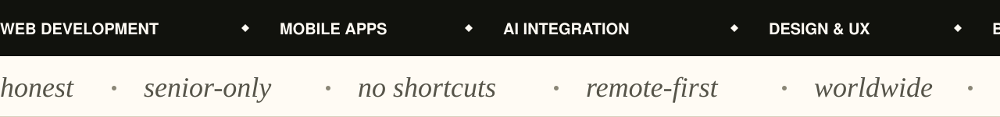
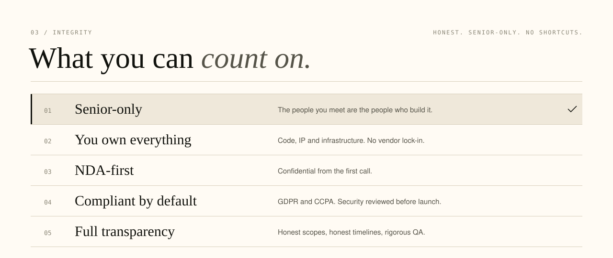
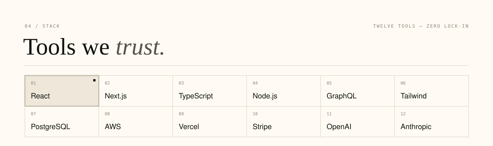

<a href="https://dimensitylabs.dev">
  <picture>
    <source media="(prefers-color-scheme: dark)" srcset="./assets/readme/hero-dark.svg">
    
  </picture>
</a>

<picture>
  <source media="(prefers-color-scheme: dark)" srcset="./assets/readme/marquee-dark.svg">
  
</picture>

  <a href="https://dimensitylabs.dev"><b>Website</b></a>&nbsp;&nbsp;·&nbsp;&nbsp;
  <a href="https://www.linkedin.com/company/dimensitylabs"><b>LinkedIn</b></a>&nbsp;&nbsp;·&nbsp;&nbsp;
  <a href="https://x.com/dimensitylabs"><b>X</b></a>&nbsp;&nbsp;·&nbsp;&nbsp;
  <a href="mailto:hello@dimensitylabs.dev"><b>hello@dimensitylabs.dev</b></a>

<picture>
  <source media="(prefers-color-scheme: dark)" srcset="./assets/readme/capabilities-dark.svg">
  
</picture>

<picture>
  <source media="(prefers-color-scheme: dark)" srcset="./assets/readme/method-dark.svg">
  
</picture>

<picture>
  <source media="(prefers-color-scheme: dark)" srcset="./assets/readme/terminal-dark.svg">
  
</picture>

<picture>
  <source media="(prefers-color-scheme: dark)" srcset="./assets/readme/integrity-dark.svg">
  
</picture>

<picture>
  <source media="(prefers-color-scheme: dark)" srcset="./assets/readme/stack-dark.svg">
  
</picture>

<a href="https://dimensitylabs.dev">
  <picture>
    <source media="(prefers-color-scheme: dark)" srcset="./assets/readme/cta-dark.svg">
    
  </picture>
</a>

  Dimensity Labs™ — Honest. Senior-only. No shortcuts.

